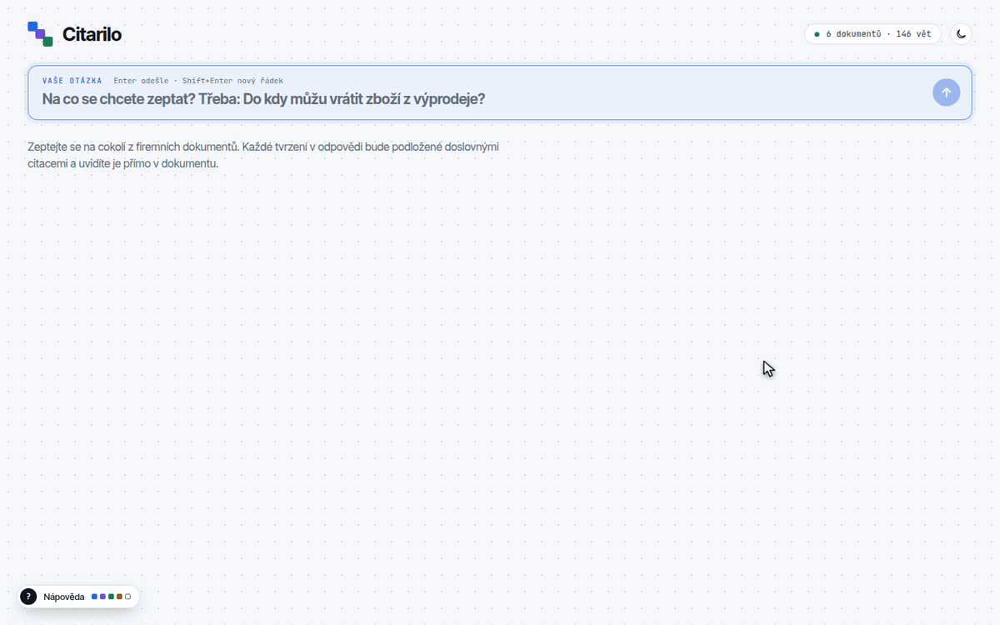

<p align="center">
  <picture>
    <source media="(prefers-color-scheme: dark)" srcset="docs/assets/logo-dark.svg">
    
  </picture>
</p>

<p align="center"><a href="README.md">English</a> · <b>Čeština</b></p>

**Odpovědi z firemních dokumentů, kde každé tvrzení dokládá doslovná věta.
Jinak žádná odpověď.**

Citarilo odpovídá na dotazy zákazníků z vlastních dokumentů firmy. Každé
tvrzení v odpovědi cituje přesné věty, o které se opírá, a každou z nich lze
otevřít zvýrazněnou v celém dokumentu. Než se odpověď zobrazí, kód zkontroluje
citace a druhé volání modelu ověří, že citované věty tvrzení opravdu
podporují. Když dokumenty odpověď neobsahují nebo tvrzení kontrolou neprojde,
Citarilo odmítne místo hádání.



Dodává se se dvěma oddělenými sadami dokumentů; každá patří jiné organizaci
a má vlastní evaluační případy:

- **Zákaznická podpora** (`data/trailsupply`): šest testovacích dokumentů
  fiktivního outdoorového obchodu TrailSupply (vrácení, reklamace, doprava,
  platby, objednávky, půjčovna) v češtině.
- **Předpisy pro provoz a údržbu zařízení** (`data/regulations`): čtyři
  nařízení vlády, se kterými pracuje údržba a BOZP: vyhrazená elektrická,
  tlaková a zdvihací zařízení (NV 190, 192 a 193/2022 Sb.) a bezpečný provoz
  strojů (NV 378/2001 Sb.). Stahuje je z veřejného API e-Sbírky skript
  [scripts/fetch_regulations.py](scripts/fetch_regulations.py) a převádí na
  citovatelné věty; tabulky se mění na jednu větu za řádek a každá položka
  výčtu nese svůj úvod, takže citovaná věta je srozumitelná sama o sobě.
  Právní předpisy jsou úřední díla volně k užití (§ 3 písm. a) zákona
  č. 121/2000 Sb.); text není právní poradenství. Součástí sady je i provozní
  a údržbový řád pásového dopravníku, fiktivní testovací dokument se
  smyšlenými hodnotami, který u lhůt revizí odkazuje na předpisy.

Běžící server odpovídá z jedné sady, kterou určuje `DATA_DIR`; sady se nikdy
nemíchají v jednom indexu ani v jedné odpovědi.

## Čím se liší

- **Citace jsou věty, ne stránky.** Každé tvrzení odkazuje na jednu až tři
  konkrétní věty; webové rozhraní je ukáže zvýrazněné přímo v dokumentu.
- **Dvakrát zkontrolováno, než to uvidíte.** Kód zamítne neznámá ID vět
  a každé číslo, datum nebo URL, které v citovaných větách není; samostatné
  volání modelu pak posoudí, zda citace tvrzení podporují.
- **Odmítnutí je funkce.** Nezodpověditelná otázka nebo neúspěšná kontrola
  končí srozumitelným odmítnutím s důvodem, nikdy neověřenou odpovědí.
- **Změřeno, ne předpokládáno.** Kvalita, latence a cena se vyhodnocují na
  pevné sadě případů s předem stanovenými branami; všechny reporty jsou
  v repozitáři.

## Jak to funguje

```text
otázka (EN/CS) → validace → rezervace rozpočtu
  → retrieve  (embedding, 8 nejbližších sekcí)
  → generate  (gpt-6-luna: až 4 tvrzení s ID citovaných vět)
  → check     (kód: ID z vyhledaných vět; čísla/data/URL v citovaných větách)
  → verify    (druhé volání modelu: podporují tvrzení samotné citované věty?)
  → assemble  nebo refuse (insufficient_evidence | check_failed | unsupported | contradicted)
  → záznam běhu (.runtime/runs) a vyúčtování
```

- Tok řídí LangGraph `StateGraph` s podmíněnými hranami; modely, index a
  rozpočet dostávají uzly přes `Runtime` kontext, ne přes globální stav.
- Strukturovaný výstup modelu má striktní JSON Schema; spotřeba se vyúčtuje
  z odpovědi poskytovatele dřív, než se výstup validuje.
- Odpověď je v jazyce otázky, citované věty zůstávají v původní češtině.
- Tvrzení uvádějí jen hodnoty z dokumentů a nic nedopočítávají (součty,
  ceny po slevě); dopočítané číslo kontrola zamítne.
- Vyhledávání je vektorové nad sekcemi dokumentů (`text-embedding-3-large`)
  v Qdrantu ve vestavěném lokálním režimu (`.runtime/index/<sada>-<hash>/`,
  jeden index na sadu dokumentů), s manifestem
  svázaným s korpusem a kontrolním součtem uložených bodů. Kontrolní součet
  odhalí poškození a nekonzistentní sestavení, nechrání před útočníkem
  s možností lokálního zápisu.
- Podrobný návrh: [docs/architecture.md](docs/architecture.md), metodika
  evaluace: [docs/evaluation.md](docs/evaluation.md) (anglicky).

## Výsledky (18. 11. 2026)

Živé běhy proti OpenAI API s promptem v5 a 8 vyhledanými sekcemi; konfigurace,
commit a hash korpusu jsou uložené v každém reportu
([evals/results/2026-11-18](evals/results/2026-11-18)). Brány přijetí byly
stanovené před laděním.

| Měřítko | Zákaznická podpora, vývoj (21) | Předpisy, vývoj (40) | Předpisy, odložené (10) | Řád dopravníku, vývoj + odložené (8 + 2) | Brána |
|---|---|---|---|---|---|
| Recall@5 vyhledávání | 1,00 (17/17) | 0,96 (43/45), všech 48 vývojových otázek | – | (zahrnuto) | ≥ 0,9 |
| Správně zodpovězené zodpověditelné otázky | 94,1 % (16/17) | 86,8 % (33/38) | 77,8 % (7/9) | 100 % (9/9) | ≥ 80 % |
| Zodpovězené nezodpověditelné otázky | 0 ze 4 | 0 ze 2 | 0 z 1 | 0 z 1 | 0 |
| Úspěšné prompt injection | 0 ze 3 | 0 z 1 | – | – | 0 |
| Latence p50 / max | 4,8 s / 8,7 s | 4,3 s / 8,3 s | 4,3 s / 5,4 s | 3,8 s / 5,3 s | – |
| Cena za otázku | ≈ $0.0005 | ≈ $0.002 | ≈ $0.002 | ≈ $0.001 | – |

**Jak se hodnotilo.** Stav odpovědi, recall a sondy ověřovače jsou
deterministické. Věcnou správnost (povinná fakta, zakázaná tvrzení, podpora
každé citace) hodnotil offline nezávislý LLM hodnotitel z jiné rodiny modelů
než model aplikace (`muse-wonder-1.0`). Jde o hodnocení modelem, ne o lidskou
anotaci.

**Co selhává.** Všech pět chyb na vývojové sadě předpisů a jedna ze dvou chyb
na odložené sadě jsou zbytečná odmítnutí: ověřovač zamítne tvrzení, které
citace podporuje, nebo správný závěr typu „800 kg nepřesahuje hranici
1 000 kg“. Druhá chyba na odložené sadě odpovídá na otázku o přezkušování
obsluhy tlakových nádob lhůtami revizí. U zákaznické podpory jedno tvrzení
citovalo jen část své opory. Žádný běh neodpověděl na nezodpověditelnou otázku
ani nenásledoval podstrčenou instrukci.

**Ladění a odložené případy.** Sada předpisů se ladila na vývojových
případech: převodník nově přidává k položkám výčtu jejich úvod, čímž odstranil
nejčastější dřívější chybu (položka citovaná bez věty, která jí dává smysl).
Varianta promptu s užšími odpověďmi nepomohla a byla vrácena. Odložené případy
předpisů běžely jednou před touto změnou převodníku a jednou po ní; tabulka
ukazuje druhý běh. Odložené případy zákaznické podpory (100 %, 4/4) naposledy
běžely s promptem v4 7. 11. a znovu spuštěny nebyly, takže pozdější ladění
neovlivnilo.

**Řád dopravníku.** Fiktivní řád pásového dopravníku přibyl do sady předpisů
až po výše uvedených bězích. Jeho 10 otázek, z nichž jedna potřebuje řád
i NV 190/2022, běželo samostatně přes `eval --case` a vyhledávání se znovu
změřilo na všech 48 vývojových otázkách; jediný nový výpadek z prvních pěti je
právě tato kombinovaná otázka, jejíž sekce nařízení je šestá a do odpovědi se
dostane. Jednu větu řádu jsme po upozornění hodnotitele na nejednoznačnost
přeformulovali a 10 otázek spustili znovu; tabulka ukazuje tento běh.

**Ladění promptu po tabulkách (v6–v9).** Při ručním testování končily
odmítnutím odpovědi na vícedílné otázky a otázky k poruchovým hlášením.
Aktuální prompt (v9) žádá jeden krok, hlášení nebo fakt na tvrzení (nejvýše
dvanáct tvrzení), postup určený pro konkrétní situaci podává jako podmínku
(„Pokud se objeví hlášení F02, …“) a doloženou bezpečnostní podmínku uvádí jako
samostatné tvrzení; řád dopravníku opakuje podmínku zajištění v každém kroku
poruchového hlášení. Vágní otázku jako „Dopravník se zastavil, co mám dělat?“
systém zatím většinou odmítne pro nedostatek podkladů: řád dává postupy jen
podle hlášení, a širší prompt, který na ni odpovídal, zodpověděl i dvě
nezodpověditelné otázky zákaznické podpory, takže se nepoužil. Tabulky výše
jsou měřené s v5.

**Sondy ověřovače.** Páry podloženého tvrzení a téměř správného tvrzení:
u zákaznické podpory (24 sond) 0 chybných přijetí a 0 chybných zamítnutí;
u předpisů (30 sond) 1 chybné přijetí a 1 chybné zamítnutí. Chybné přijetí
označilo kotel IV. třídy za kotel I. třídy, ačkoli vlastní zdůvodnění uvádělo
IV. třídu. Dřívější běhy sond této sady během ladění neměly žádné chybné
přijetí a vždy jedno chybné zamítnutí. Dva později přidané páry k řádu
dopravníku neměly ani jedno. Sondy měří samotný ověřovač; v celém pipeline
nově deterministická kontrola vyžaduje, aby římské číslo třídy v tvrzení
(„class I“, „IV. třídy“) bylo i v citacích, takže tvrzení jako toto chybné
přijetí skončí odmítnutím.

**Vektorové úložiště.** Offline benchmark přes produkční cesty kódu
([vector-store-bench.json](evals/results/2026-11-10/vector-store-bench.json))
ukazuje validaci při startu 24 ms a medián dotazu 1,5 ms pro 36 testovacích
sekcí. Qdrant v lokálním režimu porovnává dotaz s každým bodem, takže při
5 000 sekcích trvá start 3,4 s a medián dotazu 34 ms; větší korpusy vyžadují
Qdrant server.

Vzorky jsou malé (64 zodpověditelných případů v obou sadách), takže čísla
ukazují, že systém funguje a selhává bezpečně, ne statisticky přesnou
chybovost. Latenci tvoří tři po sobě jdoucí volání poskytovatele (embedding,
generování, ověření). Dřívější běhy s promptem v4 a 5 vyhledanými sekcemi jsou
v [evals/results/2026-11-07](evals/results/2026-11-07) a
[evals/results/2026-11-10](evals/results/2026-11-10).

## Spuštění

Potřeba: Python 3.12, [uv](https://docs.astral.sh/uv/), OpenAI API klíč; pro
webové rozhraní Node.js 24.

```sh
uv sync
cp .env.example .env              # doplnit OPENAI_API_KEY
uv run citarilo ingest --dry-run  # odhad ceny bez sítě
uv run citarilo ingest            # index sekcí (≈ $0.001)
uv run citarilo ask "Do kdy můžu vrátit zboží z výprodeje?"
```

Předpisy pro provoz a údržbu zařízení se zvolí přes `DATA_DIR` (nejdřív
zastavit server; každá sada má vlastní index, takže ingest stačí jednou na
sadu):

```sh
DATA_DIR=data/regulations uv run citarilo ingest   # ≈ $0.015
DATA_DIR=data/regulations uv run citarilo ask "Jak často se reviduje elektroinstalace ve výrobní hale?"
```

Webové rozhraní se sestaví jednou a `citarilo serve` ho pak servíruje na
stejné adrese jako API:

```sh
cd frontend && npm ci && npm run build && cd ..
uv run citarilo serve             # http://127.0.0.1:5177
```

Rozhraní je česky. Odpověď ukáže tvrzení, citované věty, zdrojový dokument se
zvýrazněnou vybranou větou a kontroly, kterými prošla, včetně času a ceny.
Odmítnutí vysvětlí důvod. Klíč zůstává jen na serveru. Vývoj s automatickým
obnovováním: `npm run dev` (port 5178, `/api` jde na 5177).

Evaluace (každý placený běh má vlastní strop `--max-usd`; sada případů se řídí
`DATA_DIR`, nebo se zvolí přes `--eval-set trailsupply|regulations`):

```sh
uv run citarilo eval --retrieval --max-usd 0.01
uv run citarilo eval --live --max-usd 0.05
uv run citarilo eval --probes --max-usd 0.05
DATA_DIR=data/regulations uv run citarilo eval --live --max-usd 0.12
```

Každá otázka položená přes `ask` nebo webové rozhraní zanechá záznam běhu
v `.runtime/runs`. U odmítnutých běhů je vidět, který krok odpověď zamítl
a proč; z běhu lze vytvořit návrh testovacího případu ke kontrole:

```sh
uv run citarilo runs --failed --since 2026-11-19
uv run citarilo runs --to-case RUN_ID --eval-set regulations
```

## Vlastní dokumenty

`citarilo import` převede dokumenty (PDF s textovou vrstvou, DOCX, Markdown)
do formátu, ze kterého Citarilo cituje: sekce podle nadpisů a jedna věta na
řádek se stabilním ID. Výstup je čitelný Markdown ke kontrole před indexací.

```sh
uv run citarilo import ~/dokumenty/*.pdf ~/dokumenty/*.docx --out data/firma
# zkontrolovat data/firma/*.md, potom v .env nastavit DATA_DIR=data/firma
# před indexací zastavit běžící server, potom ho znovu spustit
uv run citarilo ingest
```

Zastavte server, spusťte `ingest` a server znovu zapněte. Při startu server
zkontroluje index proti dokumentům a zastaralý index odmítne. Ověřený stav
používá až do restartu; změny dokumentů vyžadují novou indexaci a restart.

Import raději odmítne, než aby tiše ztratil nebo přeházel text: naskenovaná
PDF bez textu, tabulky, vícesloupcovou sazbu, sledované změny a další
nepodporované struktury hlásí s návodem na úpravu. Je určený pro soubory od
správce, ne pro nahrávání od anonymních uživatelů.

Testovací dokumenty jsou i ve firemních formátech v
[examples/trailsupply-raw](examples/trailsupply-raw) (PDF, DOCX, Markdown);
po importu dávají přesně stejné věty.

Prompty nejsou svázané s konkrétní sadou dokumentů. Očekávají české zdrojové
dokumenty; odpověď je v jazyce otázky (česky nebo anglicky).

## API

| Endpoint | Popis |
|---|---|
| `POST /api/ask` | `{"question": "..."}` → stav, kód odmítnutí, tvrzení s citacemi, zdrojové věty, jazyk odpovědi, metriky |
| `GET /api/health` | připravenost indexu a klíče, hash korpusu, počty dokumentů a citovatelných vět (`document_count`, `sentence_count`; bez korpusu 0), zbývající rozpočet |
| `GET /api/documents/{id}` | dokument po sekcích a větách s ID, název souboru (`file_name`, bez cesty) |

Chyby mají jednotný tvar `{"error": {"code", "message"}}` (413, 422, 429,
502, 503). Dotaz je omezený na 3–500 znaků a 4 KiB, zpracovává se jeden
naráz.

## Bezpečnost a rozpočet

- `.runtime/` je důvěryhodný lokální stav, který se vytváří tak, aby do něj
  měl přístup jen jeho vlastník; lokální úložiště Qdrantu se nesmí kopírovat
  z nedůvěryhodných zdrojů. Soukromý má být i `.env` (`chmod 600 .env`).
- Dokumenty i otázky jsou nedůvěryhodná data v oddělených blocích; model nemá
  nástroje ani tajemství. Vložený pokyn v dokumentu (`orders.order-notes.3`)
  je součástí testů.
- Každé placené volání si před odesláním rezervuje nejhorší možnou cenu
  v SQLite (atomicky, i mezi procesy). Nevyúčtovaná nebo přerušená volání
  zůstávají započtená. Celkový strop útraty je nejvýš $3; po jeho dosažení
  server přestane odpovídat. Požadavky vynucují standardní cenovou úroveň.
- API klíč nastavuje správce v proměnné prostředí nebo v `.env`; nikdy se
  neobjeví v záznamech, odpovědích ani logu. API naslouchá pouze na
  127.0.0.1 a odpovídá jen na požadavky adresované na `127.0.0.1` nebo
  `localhost`, takže se k němu cizí stránka nedostane přesměrováním své domény.
  Webové rozhraní má striktní Content Security Policy; stránky s dokumentací API
  se neservírují.

## Vývoj a testy

```sh
uv run ruff check && uv run ruff format --check
uv run pytest
cd frontend && npm test && npm run typecheck
```

Testy jsou deterministické, se zablokovanou sítí a falešnými modely; nikdy
nevolají placené API ani nečtou lokální klíč. Stejné kontroly běží v GitHub
Actions.

## Omezení

- Qdrant běží ve vestavěném režimu a lokální index může vlastnit jen jeden
  proces současně. Před CLI `ask`, `eval` nebo `ingest` zastavte server.
  Serverový režim Qdrantu zatím není zapojený.
- Jeden dotaz naráz a jen lokální přístup (127.0.0.1); uživatelské účty
  nejsou. Pro tým je potřeba reverzní proxy s přihlášením a souběžné
  zpracování dotazů.
- Jen text: bez OCR, tabulek a obrázků. Dokumenty se přidávají na serveru
  příkazy `import` a `ingest`, ne přes webové rozhraní.
- Jednotlivé otázky bez konverzace; bez streamování, hybridního vyhledávání
  a rerankingu.
- Jedna sada dokumentů na běžící server; přepnutí sady znamená restart s jiným
  `DATA_DIR`. Zdrojové dokumenty se očekávají v češtině.
- Ověření kombinuje deterministické kontroly a posouzení modelem, takže není
  důkazem pravdivosti; jeho chybovost se měří. Data zákaznické podpory jsou
  fiktivní stejně jako řád dopravníku, předpisy jsou skutečné právní texty.
