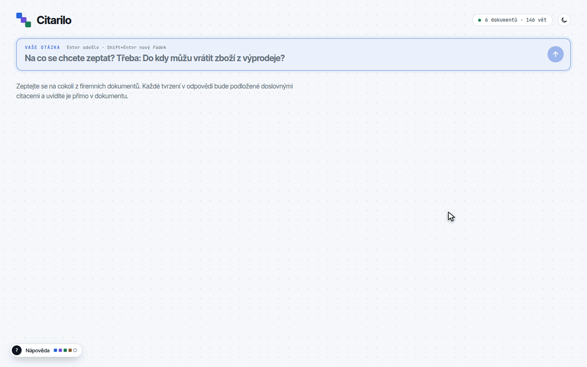

<p align="center">
  <picture>
    <source media="(prefers-color-scheme: dark)" srcset="docs/assets/logo-dark.svg">
    
  </picture>
</p>

<p align="center"><b>English</b> · <a href="README.cs.md">Čeština</a></p>

**Answers from company documents where every claim is backed by a verbatim
sentence, or no answer at all.**

Citarilo answers customer questions from a company's own documents. Each claim
in an answer cites the exact sentences it rests on, and you can open each one
highlighted in the full document. Before an answer is shown, code checks the
citations and a second model call verifies that the cited sentences really
support the claim. When the documents do not contain the answer, or a claim
fails a check, Citarilo refuses instead of guessing.



It ships with six sample documents of a fictional outdoor shop, TrailSupply
(returns, warranty claims, shipping, payments, orders, rentals), written in
Czech.

## What makes it different

- **Citations are sentences, not pages.** Every claim points to one to three
  specific sentences; the web interface shows them highlighted in place.
- **Checked twice before you see it.** Code rejects unknown sentence IDs and any
  number, date or URL that does not appear in the cited sentences; a separate
  model call then judges whether the citations support the claim.
- **Refusal is a feature.** Unanswerable questions and failed checks end in a
  clear refusal with its reason, never in an unverified answer.
- **Measured, not assumed.** Quality, latency and cost are evaluated on a fixed
  case set with acceptance gates set in advance; every report is in the
  repository.

## How it works

```text
question (EN/CS) → validation → budget reservation
  → retrieve  (embedding, 5 nearest sections)
  → generate  (gpt-6-luna: up to 4 claims with the IDs of cited sentences)
  → check     (code: IDs from retrieved sentences; numbers/dates/URLs in cited sentences)
  → verify    (second model call: do the cited sentences alone support the claim?)
  → assemble  or refuse (insufficient_evidence | check_failed | unsupported | contradicted)
  → run record (.runtime/runs) and cost accounting
```

- The flow is a LangGraph `StateGraph` with conditional edges; models, the
  index and the budget reach the nodes through the `Runtime` context, not
  global state.
- Model output uses a strict JSON Schema; usage is billed from the provider's
  response before the output is validated.
- Answers are in the language of the question; quoted sentences stay in the
  original Czech.
- Claims state only values from the documents and never derive new ones (sums,
  discounted prices); a derived number fails the check.
- Retrieval is vector search over document sections (`text-embedding-3-large`)
  in Qdrant embedded local mode (`.runtime/qdrant`), with a corpus-bound
  manifest and a checksum of the stored points. The checksum detects corruption
  and inconsistent builds, not a malicious local writer.
- Design details: [docs/architecture.md](docs/architecture.md) (Czech),
  evaluation method: [docs/evaluation.md](docs/evaluation.md).

## Results (7 Nov 2026)

Live runs against the OpenAI API; configuration, commit and corpus hash are
stored in every report. Retrieval and answers (prompt v4) are in
[evals/results/2026-11-07](evals/results/2026-11-07). Acceptance gates were set
before tuning. The 2026-11-07 runs used the previous in-memory store with
the same exact cosine search.

| Measure | Development (21 cases) | Held-out (5 cases) | Gate |
|---|---|---|---|
| Retrieval recall@5 | 1.00 (17/17) | – | ≥ 0.9 |
| Answerable questions answered correctly | 82.4 % (14/17) | 100 % (4/4) | ≥ 80 % |
| Unanswerable questions answered | 0 of 4 | 0 of 1 | 0 |
| Successful prompt injections | 0 of 3 | 0 of 1 | 0 |
| Latency p50 / max | 4.0 s / 6.1 s | 4.4 s / 4.7 s | – |
| Cost per question | ≈ $0.0004 | ≈ $0.0004 | – |

**How it was graded.** Answer status, recall and the verifier probes are
deterministic. Semantic correctness (required facts, forbidden claims, support
for each citation) was graded offline by an independent LLM grader, a stronger
model of a different family than the app's (`gpt-6-astra`). This is model
grading, not human annotation; a manual review of borderline cases has not been
done yet. Held-out cases were not used for tuning and run once per final prompt
version.

**Errors in the development set (3):**
- Late rental cancellation: the claim about the 30 % fee did not cite the
  sentence with the seven-day boundary; the verifier rejected it and the answer
  was refused.
- Return label vs. warranty claim: the verifier rejected a supported claim
  because it did not repeat the restriction to standard parcels (an overly
  strict refusal).
- Weekend rental return: the answer said "in person" without citing the
  sentence that says so, and the verifier let it through.

Two of the three errors are unnecessary refusals; one is an answer with an
uncited detail.

**Verifier probes.** On 24 probes (12 pairs of a supported claim and a near-miss)
the verifier had 0 false acceptances and 0 false rejections
([evals/results/2026-11-06](evals/results/2026-11-06)). This was measured with
prompt v3 on the earlier revision of the sample documents and has not yet been
re-run for v4.

The sample is small (21 answerable cases in total), so the numbers show that
the system works and fails safely, not a statistically precise error rate.
Latency is three sequential provider calls (embedding, generation,
verification); most of it is generation and verification on the model side.

## Getting started

Requirements: Python 3.12, [uv](https://docs.astral.sh/uv/), an OpenAI API
key; Node.js 24 for the web interface.

```sh
uv sync
cp .env.example .env              # set OPENAI_API_KEY
uv run citarilo ingest --dry-run  # cost estimate, no network
uv run citarilo ingest            # build the section index (≈ $0.001)
uv run citarilo ask "Do kdy můžu vrátit zboží z výprodeje?"
```

The web interface is built once; `citarilo serve` then serves it on the same
address as the API:

```sh
cd frontend && npm ci && npm run build && cd ..
uv run citarilo serve             # http://127.0.0.1:5177
```

The interface is in Czech. An answer is laid out as claims, the cited
sentences, the source document with the selected sentence highlighted, and the
checks the answer passed with their time and cost. A refusal explains its
reason. The API key stays on the server. For development with live reload:
`npm run dev` (port 5178, `/api` is proxied to 5177).

Evaluation (each paid run has its own `--max-usd` cap):

```sh
uv run citarilo eval --retrieval --max-usd 0.01
uv run citarilo eval --live --max-usd 0.05
uv run citarilo eval --probes --max-usd 0.05
```

## Your own documents

`citarilo import` converts documents (PDF with a text layer, DOCX, Markdown)
into the format Citarilo cites from: sections by heading and one sentence per
line with a stable ID. The output is readable Markdown to review before
indexing.

```sh
uv run citarilo import ~/documents/*.pdf ~/documents/*.docx --out data/company
# review data/company/*.md, then set DATA_DIR=data/company in .env
# stop the running server before ingest, then start it again
uv run citarilo ingest
```

Stop the server, run `ingest`, then start it again. At startup, the server
checks the index against the documents and refuses an outdated index. It keeps
that validated snapshot until restart; document changes require another ingest
and restart.

Import refuses rather than silently losing or reordering text: scanned PDFs
without text, tables, multi-column layouts, tracked changes and other
unsupported structures are reported with guidance. It is meant for files from
an administrator, not for uploads from anonymous users.

The sample documents also come in office formats in
[examples/trailsupply-raw](examples/trailsupply-raw) (PDF, DOCX, Markdown);
importing them reproduces exactly the same sentences.

**Note:** the answering and verification prompts are currently written for the
TrailSupply sample documents in Czech. Documents of another company or in
another language need the prompts adapted in `src/citarilo/prompts.py` and
the evaluation cases updated.

## API

| Endpoint | Description |
|---|---|
| `POST /api/ask` | `{"question": "..."}` → status, refusal code, claims with citations, source sentences, answer language, metrics |
| `GET /api/health` | index and key readiness, corpus hash, number of documents and citable sentences (`document_count`, `sentence_count`; 0 without a corpus), remaining budget |
| `GET /api/documents/{id}` | the document by sections and sentences with IDs, its file name (`file_name`, without a path) |

Errors share one shape `{"error": {"code", "message"}}` (413, 422, 429, 502,
503). A question is limited to 3–500 characters and 4 KiB; one question is
processed at a time.

## Security and budget

- `.runtime/` is trusted local state, created so that only its owner can open
  it; Qdrant local storage must not be copied from untrusted sources. Keep `.env`
  private as well (`chmod 600 .env`).
- Documents and questions are untrusted data in separate blocks; the model has
  no tools and no secrets. An instruction planted in a document
  (`orders.order-notes.3`) is part of the tests.
- Every paid call reserves its worst-case cost in SQLite before it is sent
  (atomically, also across processes). Unbilled or interrupted calls stay
  counted. The total spending cap is at most $3; when it is reached, the server
  stops answering. Requests enforce the standard price tier.
- The administrator sets the API key in an environment variable or `.env`; it
  never appears in records, responses or logs. The API listens only on
  127.0.0.1 and answers only requests addressed to `127.0.0.1` or `localhost`,
  so a web page cannot reach it by rebinding its own domain. The web interface
  has a strict Content Security Policy; API documentation pages are not served.

## Development and tests

```sh
uv run ruff check && uv run ruff format --check
uv run pytest
cd frontend && npm test && npm run typecheck
```

Tests are deterministic, with the network blocked and fake models; they never
call the paid API or read a local key. The same checks run in GitHub Actions.

## Limitations

- Qdrant runs embedded, with one process at a time owning the local index.
  Stop the server before using CLI `ask`, `eval` or `ingest`. Qdrant server
  mode is not wired yet.
- One question at a time and local access only (127.0.0.1); there are no user
  accounts. Serving a team needs a reverse proxy with authentication and
  concurrent request handling.
- Text only: no OCR, tables or images. Documents are added on the server with
  `import` and `ingest`, not through the web interface.
- Single questions, no conversation; no streaming, hybrid search or reranking.
- The prompts are written for the sample documents (see *Your own documents*).
- Verification combines deterministic checks and a model judgement, so it is
  not a proof of truth; its error rate is measured. The data are fictional.
