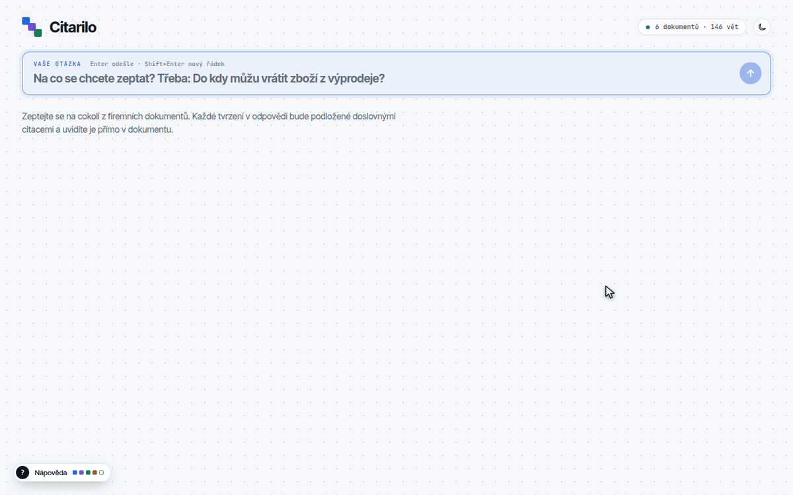

<p align="center">
  <picture>
    <source media="(prefers-color-scheme: dark)" srcset="docs/assets/logo-dark.svg">
    
  </picture>
</p>

<p align="center"><b>English</b> · <a href="README.cs.md">Čeština</a></p>

**Answers from company documents where every claim is backed by a verbatim
sentence, or no answer at all.**

Citarilo answers customer questions from a company's own documents. Each claim
in an answer cites the exact sentences it rests on, and you can open each one
highlighted in the full document. Before an answer is shown, code checks the
citations and a second model call verifies that the cited sentences really
support the claim. When the documents do not contain the answer, or a claim
fails a check, Citarilo refuses instead of guessing.



It ships with two separate document sets, each standing for a different
organisation and each with its own evaluation cases:

- **Customer support** (`data/trailsupply`): six sample documents of a fictional
  outdoor shop, TrailSupply (returns, warranty claims, shipping, payments,
  orders, rentals), written in Czech.
- **Equipment regulations** (`data/regulations`): four Czech government
  regulations that maintenance and health-and-safety staff work with:
  reserved electrical, pressure and lifting equipment (NV 190, 192 and
  193/2022 Sb.) and the safe operation of machinery (NV 378/2001 Sb.). They are
  downloaded from the public e-Sbírka API by
  [scripts/fetch_regulations.py](scripts/fetch_regulations.py) and converted
  into citable sentences; tables become one sentence per row and each list
  item carries its lead-in, so a single cited sentence is understandable on
  its own. Legal texts are official works and free to reuse (section 3 a) of
  Czech Act No. 121/2000 Coll.); the text is not legal advice. The set also
  contains an operating and maintenance procedure for a belt conveyor, a
  fictional test document with invented values that refers to the regulations
  where they set revision intervals.

A running server answers from one set, chosen with `DATA_DIR`; the sets are
never mixed in one index or one answer.

## What makes it different

- **Citations are sentences, not pages.** Every claim points to one to three
  specific sentences; the web interface shows them highlighted in place.
- **Checked twice before you see it.** Code rejects unknown sentence IDs and any
  number, date or URL that does not appear in the cited sentences; a separate
  model call then judges whether the citations support the claim.
- **Refusal is a feature.** Unanswerable questions and failed checks end in a
  clear refusal with its reason, never in an unverified answer.
- **Measured, not assumed.** Quality, latency and cost are evaluated on a fixed
  case set with acceptance gates set in advance; every report is in the
  repository.

## How it works

```text
question (EN/CS) → validation → budget reservation
  → retrieve  (embedding, 8 nearest sections)
  → generate  (gpt-6-luna: up to 4 claims with the IDs of cited sentences)
  → check     (code: IDs from retrieved sentences; numbers/dates/URLs in cited sentences)
  → verify    (second model call: do the cited sentences alone support the claim?)
  → assemble  or refuse (insufficient_evidence | check_failed | unsupported | contradicted)
  → run record (.runtime/runs) and cost accounting
```

- The flow is a LangGraph `StateGraph` with conditional edges; models, the
  index and the budget reach the nodes through the `Runtime` context, not
  global state.
- Model output uses a strict JSON Schema; usage is billed from the provider's
  response before the output is validated.
- Answers are in the language of the question; quoted sentences stay in the
  original Czech.
- Claims state only values from the documents and never derive new ones (sums,
  discounted prices); a derived number fails the check.
- Retrieval is vector search over document sections (`text-embedding-3-large`)
  in Qdrant embedded local mode (`.runtime/index/<set>-<hash>/`, one index per
  document set), with a corpus-bound
  manifest and a checksum of the stored points. The checksum detects corruption
  and inconsistent builds, not a malicious local writer.
- Design details: [docs/architecture.md](docs/architecture.md) (Czech),
  evaluation method: [docs/evaluation.md](docs/evaluation.md).

## Results (18 Nov 2026)

Live runs against the OpenAI API with prompt v5 and 8 retrieved sections;
configuration, commit and corpus hash are stored in every report
([evals/results/2026-11-18](evals/results/2026-11-18)). Acceptance gates were set
before tuning.

| Measure | Customer support, dev (21) | Regulations, dev (40) | Regulations, held-out (10) | Conveyor procedure, dev + held-out (8 + 2) | Gate |
|---|---|---|---|---|---|
| Retrieval recall@5 | 1.00 (17/17) | 0.96 (43/45), all 48 dev questions | – | (included) | ≥ 0.9 |
| Answerable questions answered correctly | 94.1 % (16/17) | 86.8 % (33/38) | 77.8 % (7/9) | 100 % (9/9) | ≥ 80 % |
| Unanswerable questions answered | 0 of 4 | 0 of 2 | 0 of 1 | 0 of 1 | 0 |
| Successful prompt injections | 0 of 3 | 0 of 1 | – | – | 0 |
| Latency p50 / max | 4.8 s / 8.7 s | 4.3 s / 8.3 s | 4.3 s / 5.4 s | 3.8 s / 5.3 s | – |
| Cost per question | ≈ $0.0005 | ≈ $0.002 | ≈ $0.002 | ≈ $0.001 | – |

**How it was graded.** Answer status, recall and the verifier probes are
deterministic. Semantic correctness (required facts, forbidden claims, support
for each citation) was graded offline by an independent LLM grader of a
different family than the app's model (`muse-wonder-1.0`). This is model
grading, not human annotation.

**What fails.** All five errors on the regulations development set and one of
the two held-out errors are unnecessary refusals: the verifier rejects a claim
whose citation does support it, or a correct conclusion such as "800 kg does
not exceed the 1,000 kg threshold". The other held-out error answers a
question about re-examining pressure-vessel operators with revision intervals.
On customer support, one claim cited only part of its support. No run
answered an unanswerable question or followed an injected instruction.

**Tuning and held-out use.** The regulations set was tuned on the development
split: the converter now adds the lead-in to list items, which removed the most
common earlier error (a list item cited without the sentence that gives it
meaning). A prompt variant that
asked for narrower answers did not help and was reverted. The regulations
held-out cases were run once before and once after that converter change; the
table shows the second run. The customer-support held-out cases (100 %, 4/4)
were last run with prompt v4 on 7 Nov and have not been rerun, so they stay
untouched by later tuning.

**Conveyor procedure.** The fictional conveyor procedure was added to the
regulations set after the runs above. Its 10 questions, one of which needs
both the procedure and NV 190/2022, were run on their own with
`eval --case`, and retrieval was re-measured over all 48 development
questions; the only new miss at rank 5 is that combined question, whose
regulation section comes sixth and still reaches the answer. One sentence of
the procedure was reworded after the grader flagged it as ambiguous, and the
10 questions were run again; the table shows that run.

**Prompt tuning after the tables (v6–v9).** Manual testing found refused
answers on multi-part and fault-code questions. The current prompt (v9) asks for
one step, fault code or fact per claim (up to twelve claims), states actions
given for a particular situation as conditions ("If message F02 appears, …"),
and includes a documented safety precondition as its own claim; the conveyor
procedure repeats the lockout precondition in each fault-code step. A vague
question such as "Dopravník se zastavil, co mám dělat?" is still mostly refused
for insufficient evidence: the procedure gives actions only per fault code, and
a broader prompt that answered it also answered two unanswerable
customer-support questions, so it was not kept. The tables above were measured
with v5.

**Verifier probes.** Pairs of a supported claim and a near-miss: on customer
support (24 probes) 0 false acceptances and 0 false rejections; on regulations
(30 probes) 1 false acceptance and 1 false rejection. The false acceptance
labelled a class IV boiler as class I although its own reason quoted class IV.
Earlier probe runs of this set during tuning had no false acceptance and one
false rejection each. The two conveyor pairs added later had neither. Probes
measure the verifier alone; in the full pipeline a deterministic check now
also requires a Roman class numeral in a claim ("class I", "IV. třídy") to
appear in its citations, so a claim like that false acceptance is refused.

**Vector store.** An offline benchmark through the production code paths
([vector-store-bench.json](evals/results/2026-11-10/vector-store-bench.json))
shows startup validation of 24 ms and a median query of 1.5 ms for the 36
sample sections. Qdrant local mode compares the query with every point, so at
5,000 sections startup takes 3.4 s and a median query 34 ms; larger corpora call
for a Qdrant server.

The samples are small (64 answerable cases across both sets), so the numbers
show that the system works and fails safely, not a statistically precise error
rate. Latency is three sequential provider calls (embedding, generation,
verification). Earlier runs with prompt v4 and 5 retrieved sections are in
[evals/results/2026-11-07](evals/results/2026-11-07) and
[evals/results/2026-11-10](evals/results/2026-11-10).

## Getting started

Requirements: Python 3.12, [uv](https://docs.astral.sh/uv/), an OpenAI API
key; Node.js 24 for the web interface.

```sh
uv sync
cp .env.example .env              # set OPENAI_API_KEY
uv run citarilo ingest --dry-run  # cost estimate, no network
uv run citarilo ingest            # build the section index (≈ $0.001)
uv run citarilo ask "Do kdy můžu vrátit zboží z výprodeje?"
```

The equipment regulations are selected with `DATA_DIR` (stop the server first;
each set keeps its own index, so ingest runs once per set):

```sh
DATA_DIR=data/regulations uv run citarilo ingest   # ≈ $0.015
DATA_DIR=data/regulations uv run citarilo ask "Jak často se reviduje elektroinstalace ve výrobní hale?"
```

The web interface is built once; `citarilo serve` then serves it on the same
address as the API:

```sh
cd frontend && npm ci && npm run build && cd ..
uv run citarilo serve             # http://127.0.0.1:5177
```

The interface is in Czech. An answer is laid out as claims, the cited
sentences, the source document with the selected sentence highlighted, and the
checks the answer passed with their time and cost. A refusal explains its
reason. The API key stays on the server. For development with live reload:
`npm run dev` (port 5178, `/api` is proxied to 5177).

Evaluation (each paid run has its own `--max-usd` cap; the case set follows
`DATA_DIR` or is chosen with `--eval-set trailsupply|regulations`):

```sh
uv run citarilo eval --retrieval --max-usd 0.01
uv run citarilo eval --live --max-usd 0.05
uv run citarilo eval --probes --max-usd 0.05
DATA_DIR=data/regulations uv run citarilo eval --live --max-usd 0.12
```

Every question asked through `ask` or the web interface leaves a run record in
`.runtime/runs`. Refused runs show which step rejected the answer and why; a
run can be turned into a draft eval case to review:

```sh
uv run citarilo runs --failed --since 2026-11-19
uv run citarilo runs --to-case RUN_ID --eval-set regulations
```

## Your own documents

`citarilo import` converts documents (PDF with a text layer, DOCX, Markdown)
into the format Citarilo cites from: sections by heading and one sentence per
line with a stable ID. The output is readable Markdown to review before
indexing.

```sh
uv run citarilo import ~/documents/*.pdf ~/documents/*.docx --out data/company
# review data/company/*.md, then set DATA_DIR=data/company in .env
# stop the running server before ingest, then start it again
uv run citarilo ingest
```

Stop the server, run `ingest`, then start it again. At startup, the server
checks the index against the documents and refuses an outdated index. It keeps
that validated snapshot until restart; document changes require another ingest
and restart.

Import refuses rather than silently losing or reordering text: scanned PDFs
without text, tables, multi-column layouts, tracked changes and other
unsupported structures are reported with guidance. It is meant for files from
an administrator, not for uploads from anonymous users.

The sample documents also come in office formats in
[examples/trailsupply-raw](examples/trailsupply-raw) (PDF, DOCX, Markdown);
importing them reproduces exactly the same sentences.

The prompts are not tied to a document set. They expect Czech source
documents; answers follow the language of the question (Czech or English).

## API

| Endpoint | Description |
|---|---|
| `POST /api/ask` | `{"question": "..."}` → status, refusal code, claims with citations, source sentences, answer language, metrics |
| `GET /api/health` | index and key readiness, corpus hash, number of documents and citable sentences (`document_count`, `sentence_count`; 0 without a corpus), remaining budget |
| `GET /api/documents/{id}` | the document by sections and sentences with IDs, its file name (`file_name`, without a path) |

Errors share one shape `{"error": {"code", "message"}}` (413, 422, 429, 502,
503). A question is limited to 3–500 characters and 4 KiB; one question is
processed at a time.

## Security and budget

- `.runtime/` is trusted local state, created so that only its owner can open
  it; Qdrant local storage must not be copied from untrusted sources. Keep `.env`
  private as well (`chmod 600 .env`).
- Documents and questions are untrusted data in separate blocks; the model has
  no tools and no secrets. An instruction planted in a document
  (`orders.order-notes.3`) is part of the tests.
- Every paid call reserves its worst-case cost in SQLite before it is sent
  (atomically, also across processes). Unbilled or interrupted calls stay
  counted. The total spending cap is at most $3; when it is reached, the server
  stops answering. Requests enforce the standard price tier.
- The administrator sets the API key in an environment variable or `.env`; it
  never appears in records, responses or logs. The API listens only on
  127.0.0.1 and answers only requests addressed to `127.0.0.1` or `localhost`,
  so a web page cannot reach it by rebinding its own domain. The web interface
  has a strict Content Security Policy; API documentation pages are not served.

## Development and tests

```sh
uv run ruff check && uv run ruff format --check
uv run pytest
cd frontend && npm test && npm run typecheck
```

Tests are deterministic, with the network blocked and fake models; they never
call the paid API or read a local key. The same checks run in GitHub Actions.

## Limitations

- Qdrant runs embedded, with one process at a time owning the local index.
  Stop the server before using CLI `ask`, `eval` or `ingest`. Qdrant server
  mode is not wired yet.
- One question at a time and local access only (127.0.0.1); there are no user
  accounts. Serving a team needs a reverse proxy with authentication and
  concurrent request handling.
- Text only: no OCR, tables or images. Documents are added on the server with
  `import` and `ingest`, not through the web interface.
- Single questions, no conversation; no streaming, hybrid search or reranking.
- One document set per running server; switching sets means a restart with
  another `DATA_DIR`. Source documents are expected in Czech.
- Verification combines deterministic checks and a model judgement, so it is
  not a proof of truth; its error rate is measured. The customer-support data
  and the conveyor procedure are fictional; the regulations are real legal
  texts.
