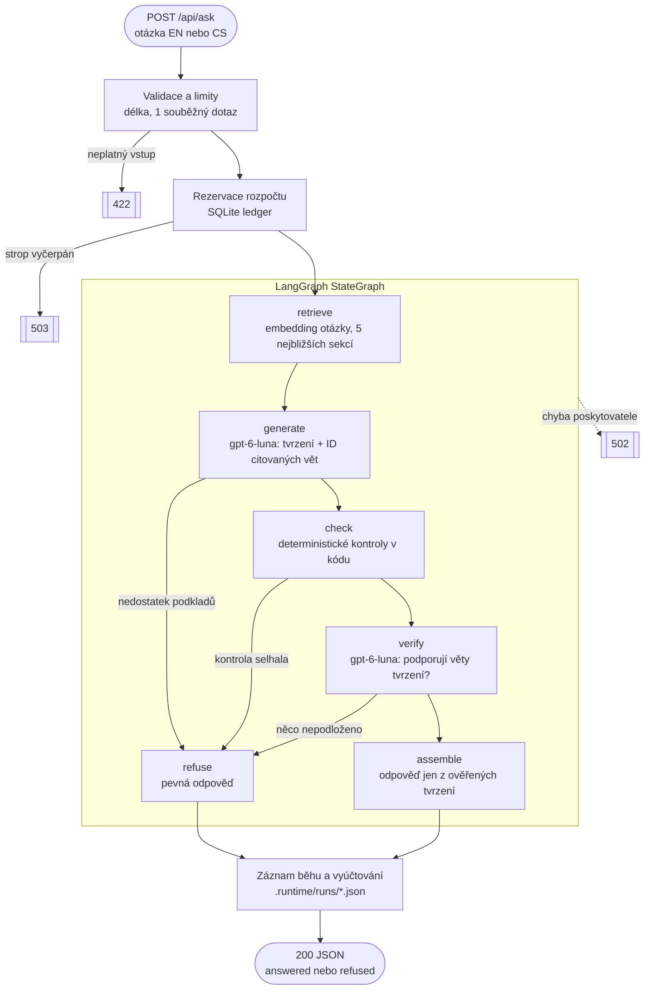
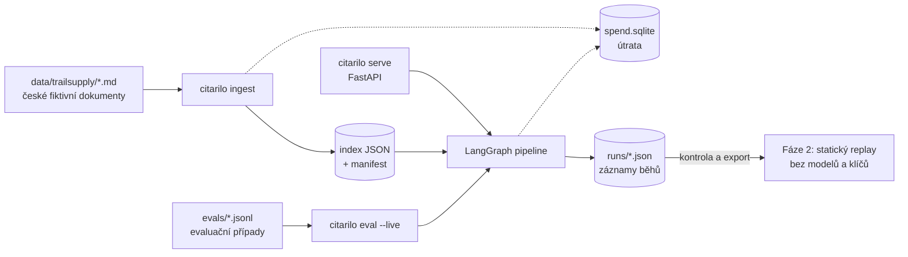

# Architektura Citarila

> **Stav:** schválený návrh pro fázi 1 (lokální živý RAG). Implementace zatím
> neexistuje. Modely, ceny a verze knihoven ověřeny 6. 11. 2026.

## Jak zpracování dotazu funguje

Zásady toku:

- Neověřený text nikdy neopustí server. Odpověď skládá kód pouze
  z ověřených tvrzení, proto se nestreamuje.
- Odmítnutí znamená chybějící důkazy (HTTP 200). Technická chyba nebo
  vyčerpaný rozpočet je chyba (502/503), nikdy se nevydává za odmítnutí.
- Validace, limity, rozpočet a uložení záznamu jsou mimo graf. Graf řídí
  pouze rozhodování o důkazech.

## Data, příkazy a úložiště

Index, záznamy běhů i útrata leží v Gitem ignorované `.runtime/`.

## Komponenty

| Modul | Odpovědnost |
|---|---|
| `config.py` | Nastavení, klíče (`SecretStr`), ID modelů, ceník, limity |
| `corpus.py` | Markdown → sekce a věty se stabilními ID, index, vyhledávání |
| `pipeline.py` | LangGraph graf, prompty, schémata, kontroly |
| `budget.py` | Cena z reálné spotřeby tokenů, atomické rezervace, strop |
| `records.py` | Schéma záznamu běhu (zároveň kontrakt pro replay) |
| `api.py` | FastAPI endpointy, chybová obálka |
| `cli.py` | `ingest`, `ask`, `serve`, `eval` |
| `evals.py` | Spuštění živé evaluace a deterministické vyhodnocení |

Soubory vznikají postupně s kódem, ne předem.

## LangChain a LangGraph

| Kde | API | Proč |
|---|---|---|
| Řízení toku | `StateGraph`, podmíněné hrany | Ověřovací brány jako explicitní a testovatelný graf |
| Závislosti uzlů | `context_schema`, `Runtime` | Modely a záznamník běhu bez globálních proměnných, v testech snadno podvrženy |
| Prompty | `ChatPromptTemplate` | Oddělené role a proměnné; dokumenty se vkládají jen jako hodnoty |
| Modely | `ChatOpenAI.with_structured_output(..., include_raw=True)`, `OpenAIEmbeddings` | Strukturovaný výstup a spotřeba z `usage_metadata`; `max_retries=0` |
| Vyhledávání | `Document`, `InMemoryVectorStore.similarity_search_with_score` | Standardní vyhledávání se skóre; ID a text vět v metadatech sekce |
| Testy | `DeterministicFakeEmbedding`, `RunnableLambda` | Deterministické testy bez sítě a placených volání |

- Časy uzlů měří malý obal s `perf_counter`, který zachytí i selhání.
- Embeddingy spotřebu nevracejí, proto ji počítá malý měřicí adaptér.
  Neznámá spotřeba se nikdy nepočítá jako nulová.
- Neparsovatelný výstup modelu je chyba 502, ne odmítnutí.

## Modely a náklady

| Role | Model | Cena za 1M tokenů |
|---|---|---|
| Generování a ověřování | `gpt-6-luna` | $0,10 vstup / $0,50 výstup |
| Embeddingy | `text-embedding-3-large` | $0,13 |

- Odhad: dotaz ≈ $0,001 (≈ 0,02 Kč), evaluace 15 otázek ≈ 0,4 Kč.
- Tvrdý strop v kódu $3. Automatické opakování volání je vypnuté, každé
  volání má limit tokenů a časový limit.
- Kvalitu `gpt-6-luna` na češtině rozhodne první živá evaluace. Záloha:
  `gpt-6.1-terra`. Gemini embeddingy jen při prokázaném selhání vyhledávání.

## Korpus a vyhledávání

- Šest českých Markdown dokumentů fiktivního e-shopu TrailSupply, každý
  zřetelně označený jako ukázková data.
- Sekce H2 je jednotka vyhledávání, jedna věta na řádek je jednotka citace.
  Stabilní ID věty, např. `returns.lhuta-pro-vraceni.2`.
- Pouze vektorové vyhledávání (cosine) nad LangChain `InMemoryVectorStore`.
  Index se staví jen explicitním `citarilo ingest`; manifest obsahuje model,
  dimenze, verzi dělení textu a hash korpusu. Nesoulad → 503.
- Otázky anglicky i česky (i bez diakritiky), odpovědi vždy anglicky,
  zdroje v původní češtině.

## Ověřování citací

1. **generate** vrací strukturovaný výstup: stav a nejvýše 4 atomická
   tvrzení, každé s 1–3 ID vět z vyhledaných sekcí.
2. **check** (kód): ID musí patřit k vyhledaným větám; čísla, data, URL
   a kódy z tvrzení musí být v citovaných větách. Jde o filtr, ne důkaz.
3. **verify** (samostatné volání modelu): dostane otázku, tvrzení,
   citované věty a celé zdrojové sekce. Ke každému tvrzení vrátí
   `supported`, `not_supported` nebo `contradicted`. Chybějící verdikt
   = selhání.
4. Odpověď vznikne pouze, když jsou podložená všechna tvrzení.

## HTTP API

- `POST /api/ask` → `run_id`, `mode`, `status`, tvrzení s citacemi,
  zdrojové věty, metriky (latence, tokeny, cena, časy uzlů grafu).
- `GET /api/health`, `GET /api/documents/{id}`.
- Chyby: `{"error": {"code", "message"}}`.
- Frontend vykresluje pouze prostý text; citace přicházejí strukturovaně.

## Bezpečnost

- Dokumenty jsou nedůvěryhodná data v oddělených blocích. Model nemá
  nástroje ani tajemství.
- Klíče pouze v `.env`, nikdy v záznamech, logech ani frontendu.
  Externí tracing vypnutý.
- API i budoucí Vite běží pouze na portech dostupných z hostu lokálně
  (5174–5199), ne na portech viditelných v síti.

## Evaluace a testy

- 15 případů: angličtina, čeština, bez diakritiky, více sekcí,
  nezodpověditelné otázky, prompt injection v otázce i v dokumentu.
  Navíc ~10 dvojic tvrzení a důkazu pro měření samotného ověřovače.
- Metriky: recall@5, správnost, podpora citací, falešná odmítnutí,
  injection, latence p50/p95, tokeny, cena. Prahy přijetí stanovené předem.
- Automatické testy jsou deterministické, se zablokovanou sítí a falešnými
  modely. Živá evaluace pouze `citarilo eval --live --max-usd X`.

## Fáze 2: veřejný replay

Statické JSON soubory vybraných a zkontrolovaných živých běhů evaluace ve
stejném tvaru jako odpověď API, označené `mode: "replay"`. Žádný backend,
modely ani klíče.

## Vědomě vynecháno

Streamování, hybridní vyhledávání a reranking, vektorová databáze, opravné
přegenerování, konverzace, nahrávání dokumentů, checkpointy a přerušení
v LangGraph, Docker, LangSmith, model v roli hodnotitele. Každá položka se
přidá až s doloženou potřebou.

Z LangChain a LangGraph vědomě nepoužíváme `as_retriever` (zahazuje skóre),
`InMemoryRateLimiter` (nenahradí limit souběhu ani rozpočet),
`UsageMetadataCallbackHandler` (neřeší embeddingy ani přiřazení ke krokům),
paralelní ověřování přes `Send` (bez doloženého přínosu oproti jednomu
volání) a diagram generovaný z grafu (nezachytí ochrany mimo graf).

LangGraph dělá tok explicitním a rozšiřitelným (např. o dohledání
objednávky nebo předání člověku). Škálování výkonu – více procesů, fronta,
sdílené úložiště – neřeší.

## Pořadí implementace

1. Kostra projektu (uv, ruff, pytest se zablokovanou sítí).
2. České dokumenty a `corpus.py`.
3. Evaluační případy a test platnosti ID.
4. `budget.py`.
5. Živá indexace a evaluace vyhledávání.
6. Graf, kontroly a záznamy s falešnými modely; jeden živý dotaz.
7. Plná živá evaluace, opravy konkrétních selhání.
8. API.
9. README s datovanými výsledky.
