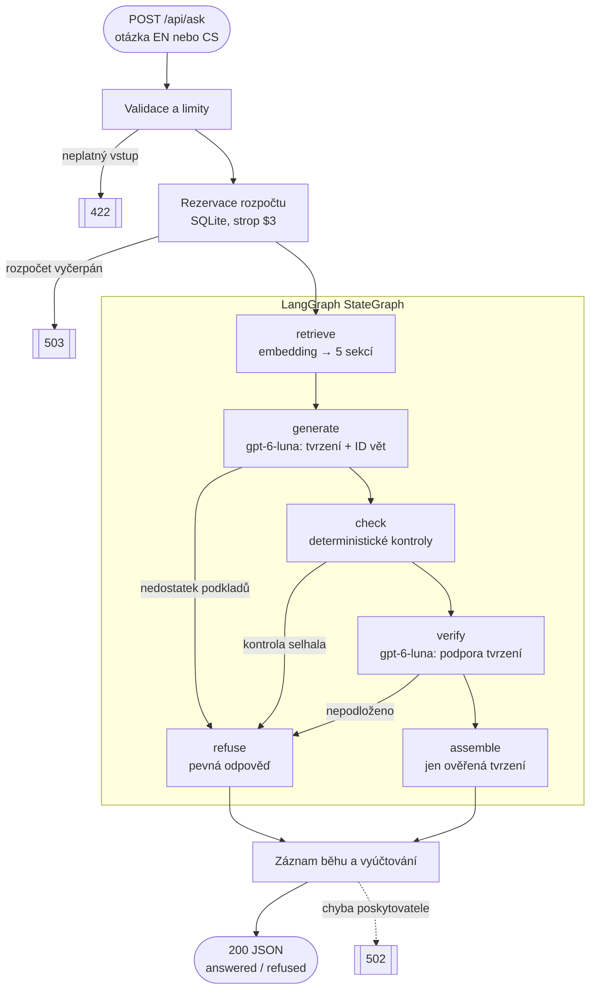
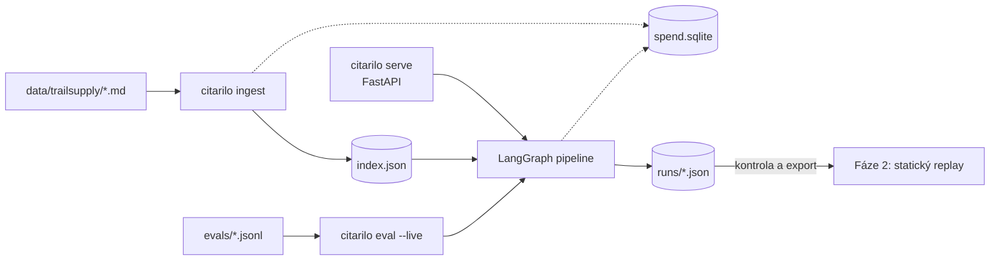

# Architektura Citarila

> **Stav:** schválený návrh pro fázi 1 (lokální živý RAG). Implementace zatím
> neexistuje. Modely, ceny a verze knihoven ověřeny 6. 11. 2026. Odhady
> nákladů jsou orientační; skutečnou spotřebu měří záznam každého běhu.

## Jak zpracování dotazu funguje



- Neověřený text nikdy neopustí server. Odpověď skládá kód pouze
  z tvrzení, která prošla kontrolami, proto se nestreamuje.
- Odmítnutí znamená chybějící nebo nepodložené důkazy (HTTP 200 s kódem
  důvodu). Technická chyba nebo vyčerpaný rozpočet je chyba (502/503).
- Validace, limity, rozpočet a uložení záznamu jsou mimo graf. Graf řídí
  pouze rozhodování o důkazech.
- Záznam běhu a vyúčtování se uloží i při chybě poskytovatele.

## Příkazy a data



Index, záznamy běhů i útrata leží v Gitem ignorované `.runtime/`.

## Struktura a komponenty

```text
pyproject.toml  uv.lock  .env.example  README.md
src/citarilo/              balíček (src layout), příkaz `citarilo` přes [project.scripts]
data/trailsupply/*.md      české fiktivní dokumenty
evals/cases.jsonl          vývojové a odložené případy
evals/verifier_cases.jsonl sondy pro měření ověřovače
tests/
.github/workflows/ci.yml   ruff + pytest bez sítě a klíčů
```

| Modul | Odpovědnost |
|---|---|
| `config.py` | Nastavení, klíče (`SecretStr`), modely, ceník, limity |
| `corpus.py` | Markdown → sekce a věty se stabilními ID, hash korpusu |
| `index.py` | Embeddingy se spotřebou, index s manifestem, vyhledávání |
| `pipeline.py` | LangGraph graf, prompty, schémata, kontroly |
| `budget.py` | Rezervace a vyúčtování v SQLite, strop |
| `records.py` | Schéma záznamu běhu (zároveň kontrakt pro replay) |
| `api.py` | FastAPI endpointy, chybová obálka |
| `cli.py` | `ingest`, `ask`, `serve`, `eval` |
| `evals.py` | Spuštění živé evaluace a vyhodnocení |

Soubory vznikají postupně s kódem, ne předem.

## LangChain a LangGraph

| Kde | API | Proč |
|---|---|---|
| Řízení toku | `StateGraph`, podmíněné hrany | Ověřovací brány jako explicitní a testovatelný graf |
| Závislosti uzlů | `context_schema`, `Runtime` | Modely a záznamník běhu bez globálních proměnných |
| Prompty | `ChatPromptTemplate` | Oddělené role a proměnné; dokumenty se vkládají jen jako hodnoty |
| Generování | `ChatOpenAI` (Responses API), `with_structured_output(method="json_schema", strict=True, include_raw=True)` | Striktní schéma výstupu a spotřeba z `usage_metadata` |
| Vyhledávání | `Document`, `InMemoryVectorStore.similarity_search_with_score` | Standardní vyhledávání se skóre; ID a text vět v metadatech |
| Testy | `DeterministicFakeEmbedding`, `RunnableLambda` | Deterministické testy bez sítě a placených volání |

- Embeddingy: OpenAI API spotřebu vrací, ale rozhraní LangChain
  `Embeddings` ji zahazuje. Tenký adaptér nad OpenAI SDK implementuje
  totéž rozhraní a spotřebu zachová.
- Časy uzlů měří malý obal s `perf_counter`, který zachytí i selhání.
- Neparsovatelný výstup modelu je chyba 502, ne odmítnutí.

## Modely a nastavení

| Role | Model | Cena za 1M tokenů |
|---|---|---|
| Generování a ověřování | `gpt-6-luna` | $0,10 vstup / $0,50 výstup |
| Embeddingy | `text-embedding-3-large` | $0,13 |

- Reasoning effort: `none` pro generování, `low` pro ověřování. Výchozí
  volba; změnu rozhoduje evaluace.
- `store=False`, `max_retries=0`, časový limit a limit výstupních tokenů
  u každého volání. Verze knihoven zamknuté v `uv.lock`.
- Model, nastavení a verze ceníku se ukládají do každého záznamu běhu.
- Pokud evaluace ukáže slabou češtinu, záloha je `gpt-6.1-terra`
  ($1 / $5): změna jednoho řádku konfigurace.
- Orientačně: dotaz ≈ $0,001 (≈ 0,02 Kč), evaluace 20 případů ≈ 0,5 Kč.

## Rozpočet

- Každý placený vstup (`ingest`, `ask`, `eval`) před voláním rezervuje
  v SQLite nejvyšší možnou cenu podle limitů vstupu a výstupu. Po volání
  se vyúčtuje skutečná spotřeba.
- Timeout, pád procesu nebo chybějící údaj o spotřebě: rezervace zůstává
  započtená jako útrata.
- Strop $3 pro OpenAI; evaluace má navíc vlastní `--max-usd`.
- Žádné automatické opakování ani přepnutí na jiný model.

## Korpus a vyhledávání

- Šest českých Markdown dokumentů fiktivního e-shopu TrailSupply, každý
  zřetelně označený jako ukázková data.
- Sekce H2 nese explicitní anglické ID (`## Lhůta pro vrácení {#return-window}`)
  a je jednotkou vyhledávání. Jedna věta na řádek je jednotka citace:
  `returns.return-window.2`.
- ID platí vždy spolu s hashem korpusu, který obsahuje každý záznam běhu.
- Pouze vektorové vyhledávání, 5 nejbližších sekcí. Index se staví jen
  explicitním `citarilo ingest`; manifest obsahuje model, dimenze, verzi
  dělení textu a hash korpusu. Nesoulad → 503.
- Otázky anglicky i česky (i bez diakritiky), odpovědi vždy anglicky,
  zdroje v původní češtině.

## Ověřování citací

1. **generate** vrací nejvýše 4 atomická tvrzení, každé s 1–3 ID vět
   z vyhledaných sekcí.
2. **check** (kód): ID musí patřit k vyhledaným větám; čísla, data a URL
   z tvrzení musí být po normalizaci (české a anglické formáty) v citovaných
   větách. Jde o filtr, ne důkaz.
3. **verify** (samostatné volání modelu): podporu musí nést samotné
   citované věty. Celé sekce slouží jen k odhalení podmínek, výjimek
   a rozporů. Každé tvrzení má právě jeden verdikt; chybějící nebo
   duplicitní verdikt je selhání.
4. Odpověď vznikne, jen když jsou podložená všechna tvrzení. Jinak
   odmítnutí s kódem `insufficient_evidence`, `check_failed`,
   `unsupported` nebo `contradicted`.

Ověření kombinuje deterministické filtry s kontrolou modelem, takže není
důkazem pravdivosti. Jeho chybovost měříme (viz Evaluace).

## HTTP API

- `POST /api/ask` → `run_id`, `mode`, `status`, kód důvodu odmítnutí,
  tvrzení s citacemi, zdrojové věty, metriky (latence, tokeny, cena,
  časy uzlů).
- `GET /api/health`, `GET /api/documents/{id}`.
- Chyby: `{"error": {"code", "message"}}`.
- Frontend vykresluje pouze prostý text; citace přicházejí strukturovaně.

## Bezpečnost

- Dokumenty jsou nedůvěryhodná data v oddělených blocích. Model nemá
  nástroje ani tajemství.
- Vstup: otázka 3–500 znaků, tělo požadavku nejvýše 4 KiB, žádná
  neznámá pole, 1 souběžný dotaz.
- Klíče pouze v `.env`, nikdy v záznamech, logech ani frontendu.
  Externí tracing vypnutý.
- API i budoucí Vite běží pouze na portech dostupných z hostu lokálně
  (5174–5199), ne na portech viditelných v síti.

## Evaluace a testy

- **Případy:** 15 vývojových a 5 odložených. Odložené se při ladění
  nepoužívají a spustí se jednou na konci. Každý případ má ručně určený
  očekávaný stav, povinná fakta, zakázaná tvrzení a podpůrné věty.
  Pokrytí: angličtina, čeština, bez diakritiky, více sekcí,
  nezodpověditelné otázky, prompt injection v otázce i v dokumentu.
- **Hodnocení:** odpověď je správná, když má očekávaný stav, všechna
  povinná fakta, žádné zakázané tvrzení a každá citace tvrzení podporuje.
  Podporu citací u každé živé odpovědi hodnotí agent v T3 (silnější model
  jiného typu, bez nákladů z API), uživatel kontroluje namátkově. README
  to uvádí jako hodnocení agentem.
- **Brány přijetí** (stanovené před laděním): recall@5 ≥ 0,9; správně
  zodpovězeno ≥ 80 % zodpověditelných; 0 zodpovězených nezodpověditelných;
  0 úspěšných injection; 0 falešných přijetí v sondách ověřovače. Změnu
  brány musí zdůvodnit README.
- **Přínos ověřovače:** z uložených kandidátních tvrzení měříme, kolik
  nepodložených tvrzení `verify` zachytil a kolik správných odmítl,
  bez dalších placených volání.
- **Výkon:** latence p50 a maximum (p95 při 20 vzorcích nemá vypovídací
  hodnotu), tokeny, cena.
- **Testy** jsou deterministické, se zablokovanou sítí a falešnými modely;
  běží lokálně i v CI. Živá evaluace pouze `citarilo eval --live --max-usd X`.

## Záznam běhu

Každý běh ukládá: `schema_version`, `run_id`, čas, `mode` (`live`/`fake`),
původ (API nebo případ evaluace), Git commit, hash korpusu, verzi promptů,
konfiguraci (modely, reasoning, `top_k`, limity), otázku, vyhledané sekce
se skóre, kandidátní tvrzení, výsledky kontrol, verdikty, výsledek,
spotřebu a cenu každého volání, časy uzlů a případnou chybu.

## Fáze 2: veřejný replay

Statické JSON soubory vybraných a zkontrolovaných živých běhů evaluace ve
stejném tvaru jako odpověď API, označené `mode: "replay"`. Žádný backend,
modely ani klíče.

## Vědomě vynecháno

Streamování, hybridní vyhledávání a reranking, vektorová databáze, opravné
přegenerování, konverzace, nahrávání dokumentů, checkpointy a přerušení
v LangGraph, Docker, LangSmith, placený model v roli hodnotitele a napojení na
obchodní systémy. Každá položka se přidá až s doloženou potřebou.

LangGraph dělá tok explicitním a další kroky se přidávají jako uzly.
Škálování výkonu (více procesů, fronta, sdílené úložiště) neřeší.

## Pořadí implementace

1. Kostra: src layout, uv, ruff, pytest se zablokovanou sítí, CI.
2. České dokumenty a `corpus.py`.
3. Evaluační případy (vývojové i odložené) a test platnosti ID.
4. `budget.py`.
5. Živá indexace a evaluace vyhledávání.
6. Graf, kontroly a záznamy s falešnými modely; jeden živý dotaz.
7. Plná živá evaluace vývojových případů, opravy konkrétních selhání.
8. API.
9. Jednorázový běh odložených případů, README s datovanými výsledky.
